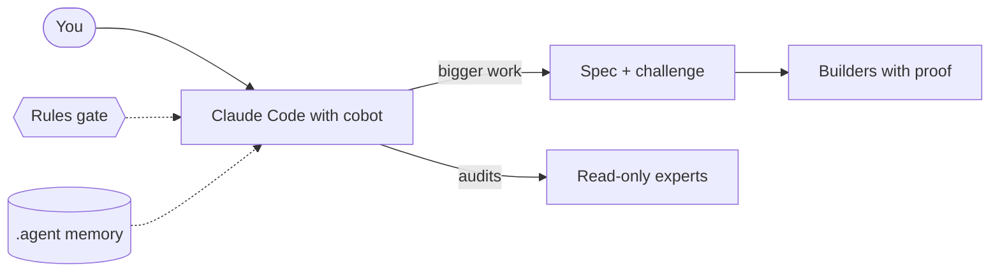

<p align="center">
  
</p>

<p align="center">
  <a href="https://github.com/YpNo/cobot/actions/workflows/ci.yml"></a>
  <a href="https://github.com/YpNo/cobot/releases"></a>
  <a href="LICENSE"></a>
  <a href="https://code.claude.com/docs/en/plugins"></a>
  <a href="pyproject.toml"></a>
  <a href=".github/workflows/ci.yml"></a>
</p>

**cobot turns Claude Code into a careful teammate: it plans before it builds, proves what it did,
remembers each repository, and asks before anything leaves your machine.**

## What you get

- **A plan before code.** Bigger changes start with a short spec that a fresh, independent
  reviewer attacks before anything is built.
- **Work with proof.** Rust, Go, Python, TypeScript (with React, Next.js and Vue), shell and
  Terraform work goes to builders that work in isolation and report the commands they ran with
  their exit codes; a report without proof goes back.
- **Memory per repository.** Context, verified commands, a journal and open findings live in
  `.agent/`, so each session starts where the last one stopped.
- **A rules gate.** Every shell command, file edit and MCP call passes `never`, `ask` and `allow`
  rules: force pushes, `terraform apply` and publishing never run on their own.
- **Experts on call.** GitHub Actions, GitLab CI, Gitea, containers, Google Cloud, Kubernetes,
  service mesh, UI and API experts; most audit your files read-only.

## How it works



Small requests are done directly. Bigger ones go spec → build → wrap, one pull request each.

## Install

You need Claude Code 2.1.285 or newer, Python 3.12 or newer, and git.

```bash
git clone https://github.com/YpNo/cobot.git
```

```bash
cobot/install.sh --project /path/to/your/repo
```

Use `--local` instead of `--project` in a repository you don't own (nothing is committed there),
or `--dev` to try cobot for one session without installing anything.

## First steps

1. Open Claude Code in your repository and run `/cobot:onboard`. It checks the repository is
   yours, finds the commands that build and test it, and writes the `.agent/` memory.
2. Ask for small changes as usual. cobot names the size and skips the ceremony.
3. For a bigger change: `/cobot:spec <what you want>`, then `/cobot:build <spec>`, then
   `/cobot:wrap` to run every check and record the result.

## Commands you type

| Command | What it does |
|---|---|
| `/cobot:onboard` | first contact with a repository: trust, verified commands, memory |
| `/cobot:spec <what>` | writes the spec and has it challenged |
| `/cobot:build <spec>` | builds the spec task by task, with proof |
| `/cobot:wrap` | full checks, reviews, journal; ready for a pull request |
| `/cobot:rules check "<command>"` | shows what the gate would do with a command |
| `/cobot:learn <topic>` | researches a topic from primary sources into dated knowledge |
| `/cobot:ship` | writes the CI/CD pipeline from your verified commands |
| `/cobot:contribute` | prepares a pull request to someone else's project, under their rules |
| `/cobot:security-sweep` | audits the whole repository, read-only |
| `/cobot:consult [domain]` | expert audits in parallel: `gha`, `gitlab-ci`, `containers`, `gcp`, `kubernetes`, `service-mesh`, `ui`, `api`; with no domain, every one found here |

Language skills, experts and builders load on their own when your files need them.

## Safety

The gate asks before anything outward or hard to undo, and some things it never allows. It never
approves on its own and never edits your Claude Code settings: `/cobot:rules sync` prints the
settings block for you to apply. The memory of a repository you don't trust is never loaded.
To quiet a tool you trust, add one line to `~/.claude/cobot.rules`, for example
`allow mcp__claude-in-chrome__*`. Report a vulnerability as [SECURITY.md](SECURITY.md) says,
never in a public issue.

## Learn more

For agents and architects:

- [`.agent/CONTEXT.md`](.agent/CONTEXT.md): this repository's working context and verified commands
- [docs/architecture.md](docs/architecture.md): layers, roster, flow, security model
- [docs/configuration.md](docs/configuration.md): install options, rule syntax, files, MCP servers
- [docs/development.md](docs/development.md): checks, evals, CI/CD, releasing, contributing
- [docs/02-design.md](docs/02-design.md) and [docs/adr/](docs/adr/): the design and its decisions

[Changelog](CHANGELOG.md) · [License: MIT](LICENSE)
