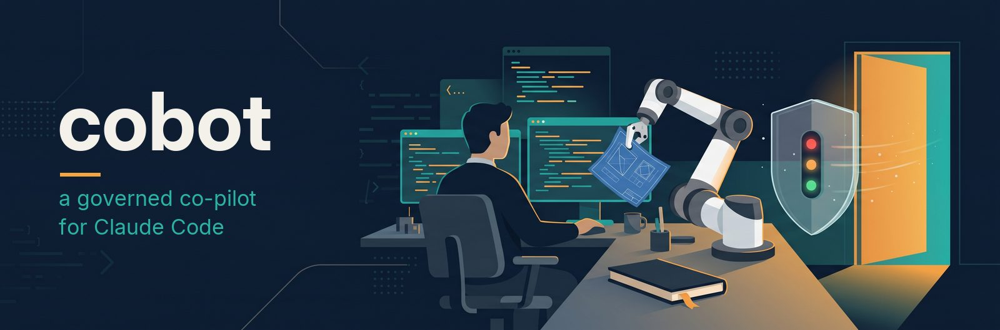
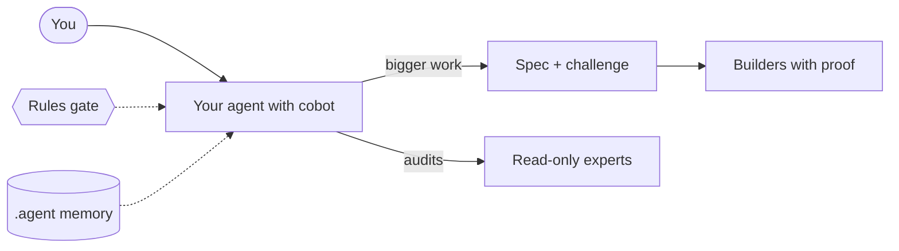

<p align="center">
  
</p>

<p align="center">
  <a href="https://github.com/YpNo/cobot/actions/workflows/ci.yml"></a>
  <a href="https://github.com/YpNo/cobot/releases"></a>
  <a href="LICENSE"></a>
  <a href="https://code.claude.com/docs/en/plugins"></a>
  <a href="docs/harnesses.md"></a>
  <a href="pyproject.toml"></a>
  <a href=".github/workflows/ci.yml"></a>
</p>

**cobot turns your AI coding agent into a careful teammate: it plans before it builds, proves
what it did, remembers each repository, and asks before anything leaves your machine.**

## Overview

You keep working the way you do: ask for a change, review it, merge it. cobot adds what a
careful colleague would bring:

- **A plan before code.** Bigger changes start with a short spec that a fresh, independent
  reviewer attacks before anything is built. Small changes skip the ceremony.
- **Work with proof.** Rust, Go, Python, TypeScript (with React, Next.js and Vue), shell and
  Terraform work goes to builders that report the commands they ran with their exit codes; a
  report without proof goes back.
- **Memory per repository.** Context, verified commands, a journal and open findings live in
  `.agent/`, committed with your code (kept outside the tree in a repository you don't own), so
  each session starts where the last one stopped.
- **A rules gate.** Every shell command, file edit and MCP call passes `never`, `ask` and
  `allow` rules: force pushes, `terraform apply` and publishing never run on their own.
- **Experts on call.** GitHub Actions, GitLab CI, Gitea, CI/CD, containers, Google Cloud,
  Kubernetes, service mesh, UI and API experts; the audits read your files and change nothing.

cobot is a plugin. It runs inside one of two supported hosts, from the same checkout:

| Host | Version | You type a command as | Status |
|---|---|---|---|
| Claude Code | 2.1.285 or newer | `/cobot:onboard` | the reference host: every feature |
| Antigravity CLI (`agy`) | 1.5.9 or newer | `/onboard` | gate, brief, skills and agents; [the gaps](#differences-under-antigravity) are named |

What was run on which version is recorded in [docs/harnesses.md](docs/harnesses.md).

## Architecture



- **The session brief.** When a session starts, cobot hands the agent its working rules, the
  repository's memory (only if you trust the repository), and one line each on stale knowledge,
  outdated dependencies and the machine.
- **The gate.** A hook judges every tool call before it runs, from three rule layers: cobot's
  defaults, yours, and the repository's (which can only tighten).
- **Skills and agents.** Workflow skills (onboard, spec, build, wrap, ship, …), knowledge skills
  per language and domain, and nine agents: a challenger, a read-only consultant and learner,
  and six builders.
- **The tools behind them.** `cobot-memory`, `cobot-rules`, `cobot-env`, `cobot-deps` and
  `cobot-session` in `plugins/cobot/bin/`: Python standard library only, tested, called by the
  hooks and skills.

Small requests are done directly. Bigger ones go spec → build → wrap, one pull request each.

Read further:

| To learn | Read |
|---|---|
| the layers, roster, flow and security model | [docs/architecture.md](docs/architecture.md) |
| install options, rule syntax, files, environment, MCP servers | [docs/configuration.md](docs/configuration.md) |
| checks, evals, CI/CD, releasing, contributing | [docs/development.md](docs/development.md) |
| what ran on which host and version | [docs/harnesses.md](docs/harnesses.md) |
| the design and its decisions | [docs/02-design.md](docs/02-design.md), [docs/01-decisions.md](docs/01-decisions.md), [docs/adr/](docs/adr/) |
| this repository's own working context | [`.agent/CONTEXT.md`](.agent/CONTEXT.md) |

## Prerequisites

- One host: Claude Code 2.1.285 or newer, or the Antigravity CLI 1.5.9 or newer (or both).
- Python 3.12 or newer on `PATH` as `python3`; cobot's tools use the standard library only.
- POSIX `sh` and `git`.

## Installation

Clone cobot once, at a release tag:

```bash
git clone --branch v0.3.0 https://github.com/YpNo/cobot.git
```

**Claude Code**, in the repository you work on:

```bash
cobot/install.sh --project /path/to/your/repo
```

Use `--local` instead of `--project` in a repository you don't own (nothing is committed
there), or `--dev` to print a one-session alias that installs nothing.

**Antigravity CLI**, once per machine (user scope). Close every agy session first; the same
command refreshes an install:

```bash
cobot/install.sh --agy
```

Install through `install.sh`, not with a bare `agy plugin install`: it gives the gate's hook
group a random name, so a repository's own hooks cannot switch it off.

For both hosts at once, add `--agy` to the Claude Code command. `cobot/install.sh --check`
reports what is installed where. After pulling a new version, `cobot/install.sh --refresh
/path/to/your/repo` (Claude Code) or `cobot/install.sh --agy` picks it up. Every option:
[docs/configuration.md](docs/configuration.md#install).

## Configuration

cobot works without configuration. What you can set, all optional:

| File | What it holds |
|---|---|
| `~/.claude/cobot.rules` | your rule layer, read under both hosts: `allow` lines quiet a default `ask`, `never` and `ask` lines tighten |
| `.agent/cobot.rules` | the repository's rule layer, committed: `never` and `ask` only |
| `~/.claude/cobot/identities`, `~/.claude/cobot/trusted` | the repositories you trust, by owner or by root commit; onboarding writes them |
| `~/.claude/cobot/machine.md` | your answers about this machine: install route, helpers you declined |

A rule is one line, for example `allow Bash(cargo test*)`, `ask Bash(git push*)` or
`allow mcp__claude-in-chrome__*`. `CLAUDE_CONFIG_DIR` moves the `~/.claude` folder above.
cobot ships no MCP server and no credentials: register the servers you want yourself, and the
gate judges their tools. The rule syntax, every file and variable, and the MCP setup for Google
Stitch and Google Cloud: [docs/configuration.md](docs/configuration.md).

## Usage

1. **Onboard each repository once.** Run `/cobot:onboard` (agy: `/onboard`). It checks the
   repository is yours, asks where things run when your machine offers more than one way, finds
   the commands that build and test it, and writes the `.agent/` memory. In a new, empty
   repository, add what the project is for (`/cobot:onboard a CLI that renames photos`): it asks
   for the profile, licence and forge, and the first spec picks the language and scaffolds it.
   If it prints `trust not recorded:` (a sandbox kept it from writing your config folder), run
   the command it gives in your own terminal.
2. **Ask for small changes as usual.** cobot names the size and skips the ceremony.
3. **For a bigger change:** `/cobot:spec <what you want>`, then `/cobot:build <spec>`, then
   `/cobot:wrap` to run every check and record the result. You push and open the pull request.

The commands you type, shown as Claude Code names them (under agy, drop `cobot:`):

| Command | What it does |
|---|---|
| `/cobot:onboard [what a new project is for]` | first contact with a repository: trust, where things run, verified commands, memory |
| `/cobot:spec <what>` | writes the spec and has it challenged |
| `/cobot:build <spec>` | builds the spec task by task, with proof |
| `/cobot:wrap` | full checks, reviews, journal; ready for a pull request |
| `/cobot:rules show \| check "<cmd>" \| explain "<cmd>" \| sync` | shows the rules and what the gate would do with a command; `sync` prints a Claude Code settings block for you to apply |
| `/cobot:learn <topic>` | researches a topic from primary sources into dated knowledge |
| `/cobot:ship` | writes the CI/CD pipeline from your verified commands |
| `/cobot:contribute` | prepares a pull request to someone else's project, under their rules |
| `/cobot:security-sweep` | audits the whole repository, read-only |
| `/cobot:consult [domain]` | expert audits in parallel: `gha`, `gitlab-ci`, `containers`, `gcp`, `kubernetes`, `service-mesh`, `ui`, `api`; with no domain, every one found here |

Language skills, experts and builders load on their own when your files need them.

### Differences under Antigravity

The gate, the session brief, the skills and the nine agents come along. What agy cannot carry:

- **Builder proof is asked for, not enforced.** No agy hook sees a subagent's report: read the
  commands and exit codes yourself before you trust one.
- **Builders are not fully proven gated.** The gate judged a subagent's calls in the smoke run;
  a cobot builder itself and calls inside `run_workflow` have not run there yet. Review a
  builder's diff before anything outward.
- **The read-only agents read files only.** agy's hooks don't say which agent is calling, so the
  consultant and the learner get no command tool there: no `git log` or `gh api` reads.
- **`/onboard`, `/rules` and `/security-sweep` can be started by the model.** agy has no
  owner-only skills; the brief tells the model to wait for you to type them.
- **The gate fails closed by its answer.** It prints a deny on every failure it can see,
  whatever agy does with a failing hook. A machine without `sh` would still fail open.
- **A repository's own agy hooks run beside the gate.** The brief warns when a workspace holds
  hooks or plugins: read them before you let the session run.
- **Every `agy` command asks**, because `agy plugin install` replaces plugins and a nested
  `agy -p` runs outside the gate. To quiet the read-only form, add
  `allow Bash(agy plugin validate*)` to `~/.claude/cobot.rules`.

The evidence for each line: [docs/harnesses.md](docs/harnesses.md) and
[docs/reference/antigravity-mechanics.md](docs/reference/antigravity-mechanics.md).

## Testing

cobot's own tests are for contributors. The suite, with its 85 % coverage gate on
`plugins/cobot/bin`:

```bash
uv run --no-project --python 3.13 --with pytest==9.2.0 --with pytest-cov==7.1.0 pytest --cov=plugins/cobot/bin --cov-fail-under=85
```

The linters, the plugin contract and validation checks, and the paid evals (real sessions
graded against expected behaviour) are in [docs/development.md](docs/development.md#checks).

## CI/CD

`ci.yml` runs every check on each push and pull request behind one required check, `ci-ok`; the
evals run on manual dispatch. A `vX.Y.Z` tag runs `release.yml`, which publishes the GitHub
release from this changelog. `knowledge-refresh.yml` opens a weekly pull request that refreshes
the stalest knowledge. Details: [docs/development.md](docs/development.md#cicd).

## Security

- The gate asks before anything outward or hard to undo, and some things it never allows. It
  never approves a call on its own: the host's own permissions still decide what the gate lets
  through.
- cobot never edits your host's settings. `/cobot:rules sync` prints the Claude Code
  settings block for you to apply.
- The memory of a repository you don't trust is never loaded into the session.
- The gate matches commands and patterns: it stops honest and careless mistakes, not a
  determined attacker. Its model and limits: [docs/architecture.md](docs/architecture.md#security-model).

Report a vulnerability as [SECURITY.md](SECURITY.md) says, never in a public issue.

## Contributing

Branches `feat/`, `fix/`, `docs/`, `chore/` or `security/`, Conventional Commits, one spec per
branch and pull request, tests with every behaviour change. Branch work lives in a worktree under
`.claude/worktrees/`, so the main checkout stays on `main`. The full rules:
[docs/development.md](docs/development.md#contributing).

## Changelog

Every release and the unreleased changes: [CHANGELOG.md](CHANGELOG.md), in Keep a Changelog
format with Semantic Versioning.

## License

[MIT](LICENSE).
