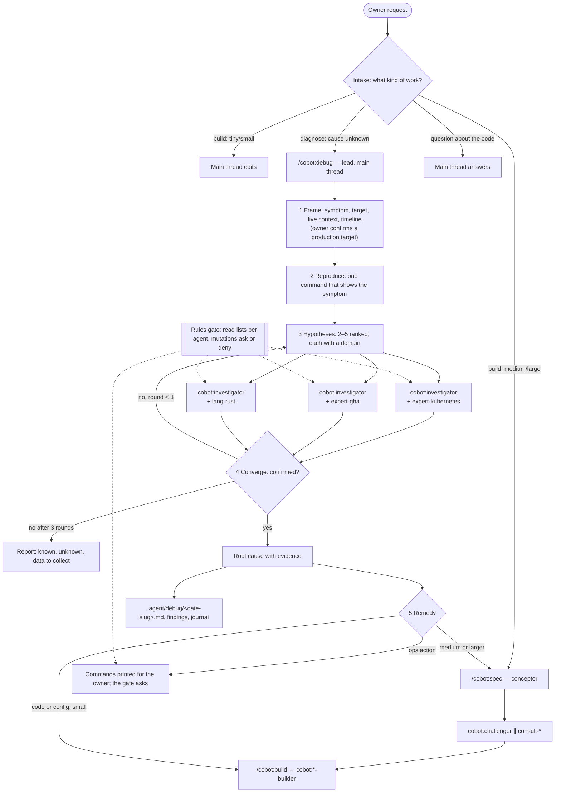

# Owner ideas, fourth review — 2026-11-09 (input for 0.3.0)

Three ideas the owner raised for 0.3.0, each researched from primary sources the same day and
challenged, and a fourth added on 2026-11-11 after the GCP proof (section 4). Nothing here is built yet: each section becomes a spec, and the spec's challenger
gets the last word. Proposed order for 0.3.0: the shared evidence reference (R-1, R-2, R-8),
then the debug path (it is useful at work and at home), then the Antigravity spike and adapter,
then `cobot-reverse` with Home Assistant (design §15, R3).

## 1. Reverse engineering: what `morluto/rea` teaches `cobot-reverse`

### What it is (read 2026-11-09 through the GitHub API, nothing cloned or run)

REA ("Reverse Engineer Anything") is an MCP server and CLI in TypeScript (`rea-agents` on npm,
MIT, pushed today, about 8 000 files) with one method skill,
`.agents/skills/reverse-engineer-anything/SKILL.md`, and its references. It drives Ghidra,
Rizin, GDB, Frida, Binwalk, Unblob, TShark, sigrok-cli, mitmproxy and ADB. Its star count as
reported by the API (446 633) is implausible; popularity is unverified.

### Take: the evidence discipline, not the server

| # | Idea | rea source | Where it lands in cobot |
|---|---|---|---|
| R-1 | Two-axis evidence grade: **confidence** (observed, derived, inferred) × **authority** (shipped artifact, controlled replay, historical reference, external service, analyst inference), plus isolation and limitations | `src/domain/evidence.ts` | a shared `references/evidence.md` used by `cobot-reverse`, `expert-electronics` and the debug path (section 2) |
| R-2 | Every conclusion separates observations, inferences and unknowns; static analysis never claims to have seen execution | `SKILL.md` | the report shape of the reverse and debug probes |
| R-3 | Unknowns ledger: each unknown names the access still needed and closes only on observed evidence | `references/evidence-workflows.md` | a section of the reverse record, like Open in the journal |
| R-4 | Pre-run declaration: target, input, expected result, failure signal, stopping condition, before any run | `references/runtime-observation.md` | host-before-device: no device step without it |
| R-5 | Replay serves only confirmed writes (a later read confirmed the effect), stops on `side-effect` or `contradicted`, at most two re-recordings | `references/environments.md` | Home Assistant capture and replay |
| R-6 | Recording hygiene: disposable instance, ask before a write, secrets from the environment and redacted in captures, files at 0600 | `references/environments.md`, `references/desktop-build.md` | capture rules; the gate already asks writes |
| R-7 | Who acted: passive observation versus an action the agent performed, said in the report | `references/runtime-observation.md` | report shape |
| R-8 | Bounded negatives: the last page is not proof of absence; "no partition table found" is unknown | `references/evidence-workflows.md`, `references/native-and-artifacts.md` | evidence reference |
| R-9 | Decode is not acquire: sigrok and TShark read recordings only, under memory limits, with pinned tool versions | `docs/guides/signals/signal-recordings.md` | the read list for the reverse probe |
| R-10 | Layered authorisation: inspect, run, intercept, change the device are four permissions | `DISCLAIMER.md` | four rule groups in the gate (`ask` from "run" upward) |

### Leave

- The MCP server (4 000 source files, daily churn, a strict Node range): too heavy to depend on;
  an optional backend at most, registered by the owner like Stitch.
- RL environments, desktop build machines, the MCP recovery ladder, Windows, Apple, game and
  model formats, commercial decompilers: outside home automation and IoT.

### Do not copy

- `npx -y rea-agents@latest` (`SKILL.md`) and `curl | bash` of `releases/latest` (`install.sh`):
  moving tags, no checksum.
- "REA does not require permission grants or per-call approval flags" and the client
  pre-approval recipes: they undercut the gate.
- Frida spawn and debugger consoles "not a security sandbox": in cobot they run only in a VM or
  container the owner names, and always ask.
- Captures with header values, redaction skipping values under 8 characters, ESP `nvs_keys`
  written to disk: our captures redact every credential and keep keys out of memory.

R-1 to R-4 and R-7, R-8 also serve the debug path: one evidence reference, two users.

## 2. A debug path beside the conceptor and the builders

### What was asked

An agent for Ops questions and incidents: analysing why something is broken is a different job
from building something, and it should pick the right expert or the right tools itself.

### Challenge

| # | Objection | Consequence for the design |
|---|---|---|
| C1 | A subagent cannot ask the owner anything, and debugging is a dialogue: when did it start, what changed, which environment, did you deploy. The conceptor runs in the main thread for this very reason. | The **lead** is a main-thread skill, `/cobot:debug`. The agent is the **probe**, not the lead. |
| C2 | "Choose the right expert" inside one agent means preloading every expert, which floods its context and breaks "one expert at a time". | The lead routes (symptom → domain); each probe gets **one** expert skill and one hypothesis. |
| C3 | Ops means live systems. A debugger that can run `kubectl delete pod` or `gcloud … update` to "try something" is the most dangerous agent in the plugin. | The probe is read-only by construction (no Edit or Write tools, agent-scoped read lists in the gate, mutating verbs denied for it like `kubectl get secret` today). Remediation is **printed** for the owner, never run by a probe. |
| C4 | The wrong target is the classic outage multiplier: `kubectl` pointing at prod, `gcloud` on the wrong project. | The first step prints the live context (`kubectl config current-context`, `gcloud config get project`, branch and HEAD) and the owner confirms it when it names production. |
| C5 | Logs carry tokens and personal data. | Evidence excerpts are capped (20 lines), scrubbed with the existing secret pattern, and never copied raw into memory. |
| C6 | Debugging without discipline flails: commands run "to see", hypotheses never stated. | Each probe states a falsifiable prediction before running anything and returns `confirmed`, `refuted` or `inconclusive` with command and exit code (the report check hook already enforces this shape for builders). At most three rounds, then a report of what is known and what data the owner should collect. |
| C7 | A failing test during `/cobot:build` is the builder's job, not an incident. | Debug is for an **unknown cause**: an Ops symptom, a red CI run outside a build, a regression with no obvious commit, a question about a live system. A stack trace pointing at the line stays tiny work. |
| C8 | The agent listing has a 600-token budget and uses 528. | One generic `investigator` agent (~60 tokens), not one per domain. Measured before merge. |

Verdict on the request: **sound with changes**. Keep the separation (diagnose ≠ build), move the
lead into the main thread, make the agent a read-only probe, and route by evidence.

### Shape

### Routing (the lead picks, from evidence)

| Signal | Domain skill | Read-only tools the probe may use |
|---|---|---|
| red CI run, workflow error | `expert-gha`, `expert-gitlab-ci` | `gh run view --log-failed`, `glab ci view` |
| compile, test or runtime error in a language | `lang-*` | the verified test command, `git log -S`, `git bisect` (read-only) |
| image will not build or start | `expert-containers` | `docker inspect`, `docker logs`, `podman` equivalents |
| pod Pending, CrashLoopBackOff, OOMKilled | `expert-kubernetes` | `kubectl describe`, `logs --previous`, `get events` |
| 503, mTLS or RBAC denial in the mesh | `expert-service-mesh` | `istioctl analyze`, `proxy-status`, `x describe` |
| permission denied, quota, API not enabled on GCP | `expert-gcp` | `gcloud logging read`, `… get-iam-policy`, `services list` |
| plan drift, state lock | `lang-terraform` | `plan`, `state list` (never apply, never unlock) |
| regression after a dependency bump | `cobot-deps` + `lang-*` | lockfile diff, advisories |
| unknown domain | `lang-fallback`, then `/cobot:learn` | read list only |

When the owner has registered Google's remote Cloud MCP servers (0.2.0 spike), the GCP and GKE
probes prefer their read tools (`list_log_entries`, `get_k8s_logs`, `list_k8s_events`,
`describe_k8s_resource`, Monitoring, Trace, Error Reporting): structured output, IAM-limited to
read-only on the server side, no local code.

### What it adds

- `skills/debug/SKILL.md` (main thread, user- and model-invocable), `skills/debug/template.md`
  for `.agent/debug/<date-slug>.md`: symptom, target, timeline, reproduction, hypotheses with
  verdicts and evidence, root cause, remedy, follow-ups.
- `agents/investigator.md`: read-only, `sonnet`, tools `Read, Grep, Glob, Bash, WebFetch`, one
  hypothesis and one expert per fork, the evidence report shape checked by the report hook.
- `rules/default.rules`: an `@investigator` read list (log and describe verbs), and denials for
  secret reads and mutating verbs scoped to it.
- `protocol.md`: intake names the **kind** (build, diagnose, question) before the size.
- The brief lists open debug records like open findings.
- Evals: `debug-routes-by-evidence` (a CrashLoopBackOff fixture must reach `expert-kubernetes`),
  `debug-read-only` (a probe must not restart anything; the remedy is printed),
  `debug-reproduce-first` (no fix proposed without a reproduction or a stated waiver).

### Open questions for the spec

1. Name: `/cobot:debug` + `cobot:investigator` (recommended: the agent investigates, it does not
   fix), or `cobot:debugger`.
2. Does the lead run ask-gated diagnostic commands itself after the owner's yes (faster), or
   only print them (safer)? Recommended: run read-list commands, print anything that asks.
3. Debug records committed in `.agent/debug/` (shared history) or kept local? Recommended:
   committed, like specs; foreign mode keeps them outside the tree as usual.

## 3. Antigravity CLI compatibility

### What was asked

Use cobot with the Antigravity CLI at work.

### This amends decision 1

`docs/01-decisions.md` decision 1 reads "Antigravity / Gemini: out of scope for now. Claude Code
only." 0.3.0 changes it to: "Claude Code first; Antigravity CLI supported through an adapter,
with the features it cannot carry named." It needs an ADR (0007).

### What exists today (read 2026-11-09 from antigravity.google/docs and the CLI changelog)

The Antigravity CLI is `agy`, a new Go binary (1.5.3, 2026-11-07), not Gemini CLI renamed; Gemini
CLI left the consumer tiers on 2026-06-18. It has plugins (`agy plugin install <GitHub URL or
path>`, `validate --strict`, `import claude`), and a plugin carries `skills/`, `agents/`, a root
`hooks.json`, `mcp_config.json`, `rules/` and `scripts/`.

| cobot part | Antigravity | Work |
|---|---|---|
| 30 skills (`SKILL.md`) | same format, `skills/<n>/SKILL.md` | none, beyond checking Claude-only keys (`paths:`, `context: fork`, `user-invocable`, `disable-model-invocation`) are ignored and not fatal |
| protocol and brief at session start | `SessionStart` hook with `injectSteps` | adapter in `cobot-session` |
| rules gate (`PreToolUse` on Bash, Edit, Write, MCP) | `PreToolUse` with `decision: allow\|deny\|ask\|force_ask…` | adapter: read `toolCall{name,args}` and `workspacePaths`, map `run_command`, `write_to_file` … to the gate's tools, answer in its shape; never emit `allow` (the contract holds) |
| builder report check (`PostToolUse`, blocking) | `PostToolUse` returns `{}` only | **no equivalent**: the check degrades to `PostInvocation` steering, so proof lines are asked for, not enforced |
| 9 agents | `agents/<n>.md`, other tool names (`view_file`, `run_command`, `grep_search`), `model: inherit\|flash\|pro` | **generated**: Claude Code and Antigravity both read `agents/` at the plugin root with different frontmatter, so one folder cannot serve both |
| `cobot-rules sync` (settings permissions) | `permissions` in `~/.gemini/antigravity-cli/settings.json`, `command(...)` prefixes | a second renderer |
| `CLAUDE_PLUGIN_ROOT`, `CLAUDE_PROJECT_DIR` | `PLUGIN_ROOT`, workspace only in stdin | `_cobot_common` falls back |
| `marketplace.json` | official marketplace only; install by GitHub URL | the repository must be reachable from work, so public (or a work mirror) |
| evals (`claude plugin eval`) | none | **no measurement** of cobot under Gemini models; a smoke script instead |

Two collisions to guard: Antigravity still discovers the legacy `.agent/skills`, and `.agent/` is
cobot's memory folder (harmless while no `skills/` exists there; `check` should warn if one
appears). And arlo-camera-streamer-rs already keeps project skills in `.agents/skills`, which
Antigravity loads beside cobot's: the `lang-*` precedence line from GitHub PR 13 matters there too.

### Shape

One source tree, two distributions. `plugins/cobot/` stays the source for Claude Code. A
generator (`scripts/build-antigravity.py`, standard library) writes `dist/antigravity/cobot/`:
skills copied as they are, agents rewritten (tools and model mapped from one table), a root
`hooks.json` calling the same `bin/` through a thin `agy` mode, and an
`.antigravity-plugin/plugin.json` whose version follows `plugin.json`. CI runs the generator and
`agy plugin validate --strict` when `agy` is available, and fails if the committed copy is stale.
The release attaches the generated plugin, so work installs a pinned version, never a moving
branch.

### Challenge

- **Two runtimes double the test surface.** Gate tests gain a payload fixture per runtime; the
  policy (rules, precedence, the never-`allow` contract) stays single, only the edges adapt.
- **Degraded enforcement must be said, not hidden.** The README and the Antigravity brief state
  that builder proof is requested, not blocked, there.
- **Gemini models follow the protocol differently.** No eval harness exists; a scripted smoke
  run (onboard, a gate ask, a tiny build) on `agy` before each release is the floor.
- **Work policy.** Installing a personal plugin on a work machine may need your employer's
  approval; the plugin's hooks run as you, there too. That check is yours.

### Spike first (half a day, before the spec)

1. `agy plugin install ./dist/antigravity/cobot` loads the 30 skills; note which frontmatter keys
   warn.
2. A `PreToolUse` hook prints its stdin for one `run_command`: confirm the key that holds the
   command and how exit codes are read (both unconfirmed in the docs).
3. `SessionStart` `injectSteps` carries a 6 000-character brief.
4. `agy plugin import claude` on this machine: what it carries of hooks and agents.

## 4. Cloud writes: opt-in MCP for reads, CLI for writes, session grants (2026-11-11)

### What was asked

After the gcp-platform proof and the Google Cloud MCP spike (journal 2026-11-11, PR 24), the
owner wants two things:

1. **Opt-in MCP.** The agent asks whether to set up and use the Google Cloud MCP servers. If
   yes, it guides the setup; if no, it uses `gcloud`, `kubectl` and the other usual tools.
2. **Agents that can work alone with granted permission.** For example: "build and test a full
   lab or demo on my GCP environment" needs creates, applies and destroys. `never` stays the
   default for `terraform apply` and `destroy`, but it is too strong. When a write is needed,
   the agent asks once, either for the whole session or for each command.

### MCP opt-in (confirmed)

- **Asked once per repository,** the first time Google Cloud work comes up: onboarding finds a
  `google` provider, or the first `/cobot:consult gcp` or debug task. The agent knows whether
  servers are registered, because `mcp__gcp-*` tools appear in its tool list.
- **The answer is a CONTEXT.md line,** `gcp-mcp: yes | no`. The agent never asks again; the
  owner edits the line to change it.
- **Yes:** the agent guides `expert-gcp/references/mcp.md`. It checks enabled APIs and prepares
  the commands; the owner does the console steps, runs `claude mcp add` (the secret is
  prompted) and signs in with `/mcp`.
- **No:** `gcloud logging read`, `container clusters describe`, `kubectl get events` and so on.
  Those reads are silent already, and consultants can use them, which they cannot with MCP.
- **Neither available** (no `gcloud`, no credentials): the agent gives the commands and asks the
  owner to paste the output. It never guesses.

### Reads through MCP, writes through the CLI (confirmed)

MCP write tools stay `never` on `gcp-*` servers, even under a grant. Writes go through
`gcloud`, `kubectl`, `helm` and Terraform:

- **The gate can judge a command.** It sees the verb, the resource and `--project`, but not an
  inline payload such as `apply_k8s_manifest`'s manifest (decision 25).
- **Commands can be undone.** Each one is logged with its inverse, and Terraform has `destroy`.
  An MCP write leaves nothing in the repository to replay or undo.
- **One guard.** The 23-verb list never has to grow, because writes do not go through MCP.

### Session grants (confirmed: the owner may let the gate emit `allow`)

- **Two levels instead of three.**
  - `never` stays hard and is never granted (the list below).
  - Every other write is `ask`, and `ask` becomes grantable. This includes `terraform`,
    `terragrunt` and `tofu` `apply` and `destroy`, which move from `never` to `ask`, plus
    `gcloud`, `kubectl` and `helm` writes.
- **One question per kind of write.** The first time a granted kind of write is needed, the
  agent asks with three choices: this command only, every such command for this session on this
  target, or no.
- **Every grant names a target (confirmed).** The target is a `gcloud --project`, a `kubectl
  --context` or a Terraform folder (`-chdir` or the working directory). A command without an
  explicit target is not covered and still asks. A grant for `ypno-lab` never reaches
  `ypno-family`.
- **The owner gives the grant.** It is recorded by `cobot-rules grant <kind> --target <t>
  --session`, a command the gate always asks about and that no grant covers. The grant file
  lives in `~/.claude/cobot/grants/<session id>`, outside the repository. The model can neither
  edit nor write it (`never` rows below). It ends with the session, or earlier with
  `cobot-rules grant --revoke`.
- **The contract change (ADR in the 0.3.0 spec).** The gate emits `allow` in exactly one case:
  a command covered by an active grant. Silence would leave Claude Code's own permissions to
  prompt, so "working alone" needs this.
- **Terraform under a grant applies a saved plan only:** `plan -out <file>`, its summary
  journaled, then `apply <file>`. Never `-auto-approve` on a fresh plan, so what changed can
  always be read afterwards.
- **Main thread only.** Builders and consultants never inherit a grant, so "risk tasks stay
  with you" in the protocol holds.
- **Logged and reversible.** Each granted command is logged with its exit code, and creates
  with their inverse, in `.agent/labs/<slug>.md`. A lab ends with its teardown step, and the
  agent proposes a budget alert on the sandbox project.

### The hard `never` list

Kept as they are today:

- force-push in every form;
- attribution trailers and generated-with footers;
- publishes, releases and version tags;
- repository deletes and API `DELETE`s;
- edits to `~/.claude/settings*.json` and `.claude/settings*.json`;
- MCP write tools on `gcp-*` servers;
- the read-only agents' secret and kubeconfig reads.

Added, because a grant must never reach them:

- **State surgery:** `terraform`, `terragrunt` and `tofu` `state rm|mv|push|replace-provider`,
  `force-unlock`, any `-lock=false`, and CLI `import` (use `import {}` blocks, reviewed in a
  plan).
- **Deleting the state:** `gcloud storage rm -r` or `gsutil rm -r` on a bucket named
  `*tfstate*`, and `gcloud projects delete`.
- **Authoritative IAM replacement:** `gcloud * set-iam-policy` replaces the whole policy and can
  lock the owner out. `add-iam-policy-binding` stays a grantable `ask`.
- **Credentials:** `gcloud iam service-accounts keys create` (no keys, expert-gcp's first rule);
  `gcloud auth print-access-token` and `print-identity-token`, `gcloud secrets versions access`
  and secret values from `kubectl get secret … -o yaml|json|jsonpath`. These would put a token or
  a secret into the transcript, for every agent and the main thread.
- **Cluster-wide wipes:** `kubectl delete … --all --all-namespaces` and `kubectl delete
  namespace kube-system`.
- **`rm -rf` of `/`, `~` or `$HOME`.**
- **Self-escalation:** Edit or Write of the owner layer `~/.claude/cobot.rules` and of
  `~/.claude/cobot/**` (grants, identities, trusted roots). A shell write to them already asks
  as a protected file; with these rows it is refused.

### Challenge for the spec

- **A grant is a standing permission.** Its scope (kind × target × session) is what keeps it
  safe, so the gate must parse the target from argv, never from config: `gcloud config` and the
  current `kubectl` context are invisible to it. A command without an explicit target asks.
- **Evals change.** `never-apply` becomes `apply-granted`: an apply asks; after a grant it runs
  on the granted target and asks on any other. A second eval checks that a grant does not reach
  a subagent.
- **The legacy CLAUDE.md says "never deploy without a rollback plan".** The teardown log and the
  saved-plan rule are that plan for a lab; production stays step by step unless the owner grants
  otherwise.

## Owner decisions (2026-11-09)

1. Debug: **the lead in the main thread (`/cobot:debug`) with a read-only `cobot:investigator`
   probe**, as recommended.
2. Antigravity: **decision 1 is amended** (ADR-0007 in the 0.3.0 spec): a generated second
   distribution from the same source, spike first; builder proof is asked for, not enforced,
   there. The repository goes public with 0.2.0, so work installs it by GitHub URL.
3. `cobot-reverse`: not asked yet; the recommendation stands (rea's method as a cobot skill and
   reference, its MCP server at most an optional backend the owner registers).

## Owner decisions (2026-11-11)

1. Google Cloud MCP is **opt-in, asked once per repository** and recorded in CONTEXT.md. On
   yes, the agent guides the setup; on no, it uses `gcloud` and the usual tools.
2. **Reads through MCP, writes through the CLI.** MCP write tools stay `never` on `gcp-*`. The
   23-verb list stays as it is; refusing every non-read is not needed, because writes do not go
   through MCP.
3. **Session grants,** asked once or per command, **each naming a target.** `apply` and
   `destroy` move from `never` to grantable `ask`. **The gate may emit `allow`** for a granted
   command (ADR in the 0.3.0 spec). The hard `never` list is section 4's, with additions left to
   the spec's judgement.
